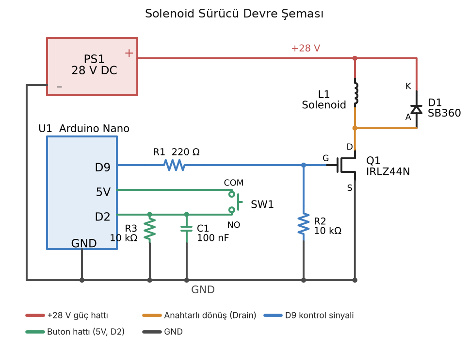
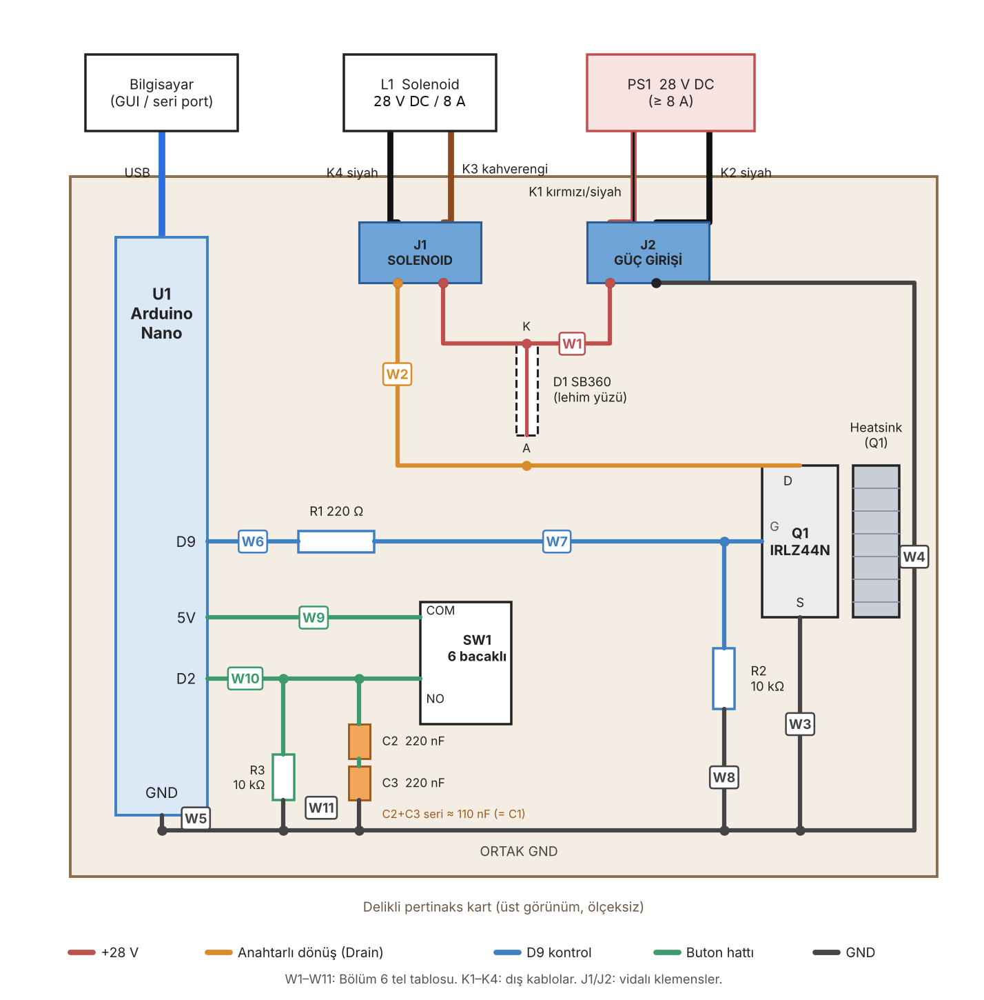
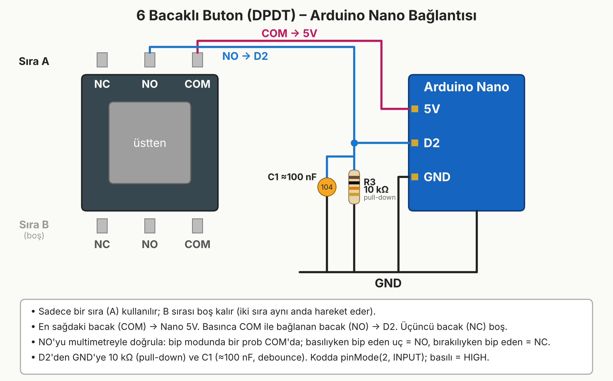
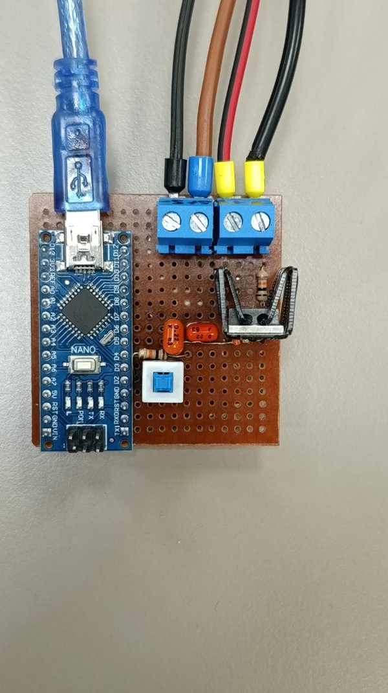
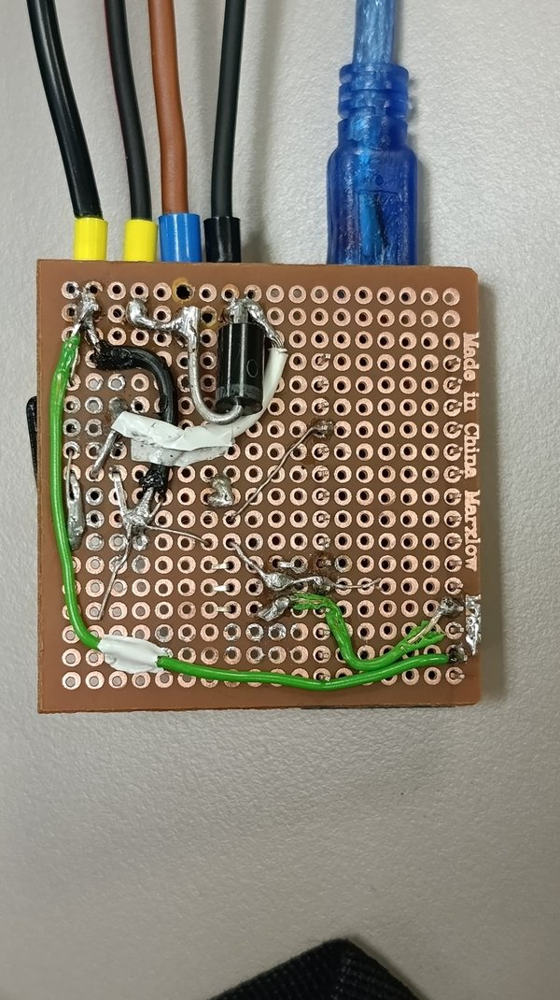

# 🔒 Kilit Solenoidi Sürücü Devresi

28 V DC ile çalışan bir kilit solenoidini, Arduino Nano'nun 5 V'luk kontrol sinyaliyle kısa darbeler hâlinde açıp kapatan sürücü devresi, kontrol yazılımı ve bilgisayar arayüzü.

Solenoid sürekli çalıştırıldığında ısındığı için tetikleme süresi milisaniye mertebesinde tutulur ve ayarlanabilir. Devre fiziksel bir butonla bilgisayarsız çalışır; süreler USB üzerinden web arayüzüyle değiştirilir.

> Staj projesi · 8.–9. haftalar (Kasım). Ayrıntılı süreç için [Ara Rapor 3](../Staj_haftalari/08_Hafta_8_9/Ara_Rapor_3.pdf).

---

## Sistem özeti

| Öğe | Değer |
|---|---|
| Yük | Kilit solenoidi, 28 V DC / 8 A (≈ 3,5 Ω) |
| Besleme | 28 V DC, ≥ 8 A |
| Kontrol | Arduino Nano (ATmega328P), USB ile beslenir |
| Anahtar | IRLZ44N N-kanal MOSFET, alt taraf (low-side) anahtarlama |
| Tetik | 6 bacaklı kilitli buton (D2), yalnızca LOW → HIGH geçişinde tetikler |
| Darbe süresi | Yazılımdan ayarlanır (10–5000 ms) |

## Gereksinimler

| No | Gereksinim | Değer |
|---|---|---|
| R1 | Solenoid beslemesi | 28 V DC / 8 A |
| R2 | Kontrol sinyali | Arduino 5 V lojik, D9 |
| R3 | Tetik | Kilitli buton, D2 |
| R4 | Açılışta istem dışı çekme olmamalı | Gate pull-down ile kapalı kalır |
| R5 | Koruma | Solenoide ters paralel flyback diyot |
| R6 | Güvenlik | Nano VIN'e 28 V verilmez, ortak GND |

## Devre

Butona basılınca D2 HIGH olur (D2'de 10 kΩ pull-down ve 100 nF donanımsal debounce, kodda ayrıca yazılımsal debounce). Nano, D9'u ayarlanan süre boyunca HIGH yapar. D9 → R1 (220 Ω) → Q1 gate yolundan Q1 iletime geçer, solenoidin (−) ucu toprağa bağlanır ve bobin çeker. D9 LOW olunca Q1 kesime gider ve D1 bobinin ters gerilimini söndürür. R2 (10 kΩ) gate'i açılışta ve Nano bağlı değilken LOW'da tutar.

### Malzeme listesi

| Kod | Parça | Değer / model | Görevi |
|---|---|---|---|
| U1 | Arduino Nano | ATmega328P | Kontrol |
| Q1 | MOSFET | IRLZ44N (TO-220, lojik seviyeli) + soğutucu | Anahtar |
| D1 | Flyback diyot | SB360 (60 V, 3 A) | Bobin ters gerilimini söndürür |
| R1 | Direnç | 220 Ω | Gate akım sınırı |
| R2 | Direnç | 10 kΩ | Gate pull-down |
| R3 | Direnç | 10 kΩ | D2 pull-down |
| C1 | Kondansatör | 100 nF (kartta 2 × 220 nF seri, ≈ 110 nF) | D2 donanım debounce |
| SW1 | Buton | 6 bacaklı DPDT kilitli | Tetik |
| J1, J2 | Vidalı klemens (2'li) | Solenoid çıkışı / güç girişi | Dış kablolar |
| PS1 | Güç kaynağı | 28 V DC, ≥ 8 A | Besleme |

### Montaj planı

Delikli pertinaks kart üzerinde kurulmuştur. Güç hattı telleri (W1–W4) en az 1,5 mm² kalın kabloyla, sinyal telleri (W5–W11) ince kabloyla yapılmıştır. Tüm GND noktaları ortak GND hattında birleşir.

Bağlantı tablosu

| Etiket | Nereden | Nereye | Kablo |
|---|---|---|---|
| K1 | PS1 (+) | J2, 1. vida | Güç, ≥ 1,5 mm² |
| K2 | PS1 (−) | J2, 2. vida | Güç, ≥ 1,5 mm² |
| K3 | Solenoid (bir uç) | J1, 2. vida | Güç, ≥ 1,5 mm² |
| K4 | Solenoid (diğer uç) | J1, 1. vida | Güç, ≥ 1,5 mm² |
| K5 | Bilgisayar | Nano mini-USB | USB kablosu |
| W1 | J2, 1. vida (+28 V) | J1, 2. vida ve D1 katot | Güç |
| W2 | J1, 1. vida | Q1 Drain ve D1 anot | Güç |
| W3 | Q1 Source | Ortak GND | Güç |
| W4 | J2, 2. vida (GND) | Ortak GND | Güç |
| W5 | Nano GND | Ortak GND | Sinyal |
| W6 | Nano D9 | R1 | Sinyal |
| W7 | R1 | Q1 Gate ve R2 | Sinyal |
| W8 | R2 | Ortak GND | Sinyal |
| W9 | Nano 5V | SW1 COM | Sinyal |
| W10 | SW1 NO | Nano D2, R3, C2 | Sinyal |
| W11 | R3, C3 | Ortak GND | Sinyal |

### Buton bağlantısı

### Kart

| Üst yüz | Lehim yüzü |
|---|---|
|  |  |

## Yazılım

| Klasör | İçerik |
|---|---|
| [`arduino/kilit_solenoid/`](arduino/kilit_solenoid) | Arduino Nano'ya Arduino IDE ile yüklenen kontrol kodu |
| [`arayuz/solenoid_arayuz.html`](arayuz/solenoid_arayuz.html) | Chrome / Edge ile açılan web arayüzü (Web Serial). Arduino olmadan denemek için **Demo** modu vardır |

Seri haberleşme 115200 baud'dur.

**Çalışma mantığı**

- D9 HIGH olunca solenoid çeker, LOW olunca bırakır. Açılışta D9 kesinlikle LOW'dur.
- Buton basılma anında (LOW → HIGH) tek darbe atar. Basılı tutmak tekrar tetiklemez; tetikleme sürerken basılırsa durdurur.
- Arayüzden **TETİKLE** ile ayarlanan süre, darbe sayısı ve aralıkla darbe dizisi atılır. Süreler `millis()` ile ölçülür, kodda `delay` yoktur.
- Buton süresi (BSURE) ve arayüz süresi (SURE) birbirinden bağımsızdır. İkisi de EEPROM'a kaydedilir; elektrik kesilse de buton kendi süresiyle çalışır.

**Ayarlar**

| Ayar | Başlangıç | Sınır |
|---|---|---|
| BSURE (buton darbe süresi) | 50 ms | 10–5000 ms |
| SURE (arayüz darbe süresi) | 50 ms | 10–5000 ms |
| TEKRAR (darbe sayısı) | 1 | 1–1000 |
| ARALIK (iki darbe arası) | 1000 ms | 100–60000 ms |

**Seri komutlar** (her komut bir satır, sonunda Enter)

| Komut | İşlev |
|---|---|
| `BSURE <ms>` | Buton darbe süresini ayarlar ve kaydeder |
| `SURE <ms>` | Arayüz darbe süresini ayarlar ve kaydeder |
| `TEKRAR <adet>` | Bir tetiklemedeki darbe sayısı |
| `ARALIK <ms>` | İki darbe arası bekleme |
| `TETIKLE` | Arayüz ayarlarıyla tetikler |
| `DURDUR` | Solenoidi hemen bırakır, devam eden diziyi iptal eder |
| `DURUM` | Ayarları ve durumu yazar |
| `KAYDET` | Ayarları belleğe yazar |

## Güvenlik

- Darbe süresi en fazla 5000 ms girilebilir; solenoid herhangi bir nedenle bundan uzun açık kalırsa kod kendisi kapatır (`IPTAL zaman asimi`).
- Solenoid sürekli açık bırakılmamalıdır; çalışırken yaklaşık 224 W çeker, bobin ve Q1 ısınır.
- Nano VIN pinine 28 V verilmez, Nano USB ile beslenir.
- Direnç veya süreklilik ölçümü yalnızca 28 V bağlı değilken yapılır.
