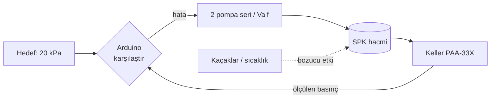

# SPK Basınç Kontrol Sistemi

**SPK**, uçakların pitot ve statik portlarına basınç uygulayarak irtifa ve hız simüle eden bir hava veri test cihazıdır. Bu projede SPK'nın bağlı olduğu ortamı **20 kPa** basınçta sabit tutan bir kapalı çevrim kontrol sistemi tasarlıyorum.

## Sistem

| Rol | Bileşen | Görevi |
|---|---|---|
| Ölçüm | Keller PAA-33X basınç sensörü | Ortamdaki basıncı ölçer |
| Karar | Arduino | Ölçümü hedefle karşılaştırır, ne yapılacağına karar verir |
| Eylem | 2 vakum pompası (seri) + L298N, solenoid valf + röle | Pompalar basıncı düşürür, valf yükseltir |
| Süreç | SPK statik hattı ve bağlantı boruları | Kontrol edilen sistem |

## Aşamalar

1. Problem tanımı ve gereksinimler
2. Temel kavramlar (basınç, vakum, mutlak/gauge)
3. Sistem mimarisi ve blok diyagram
4. Donanım seçimi ve datasheet incelemeleri
5. Sensör okuma ve kalibrasyon
6. Kontrol algoritması
7. Yazılım
8. Test ve doğrulama
9. Raporlama

İlgili kavramlar: [Basınç ve Ölçüm](../../Staj_haftalari/Keywords/01_Basinc_ve_Olcum.md) · [Pnömatik ve Valfler](../../Staj_haftalari/Keywords/07_Pnomatik_ve_Valfler.md) · [Güç Elektroniği ve Sürücüler](../../Staj_haftalari/Keywords/05_Guc_Elektronigi_ve_Suruculer.md)
