<h1>🔑 Keywords</h1>

<b>Staj sürecinde karşılaştığım teknik terimler, konu gruplarına ayrılmış hâlde</b>

 

---

## 🗂️ Keyword Grupları

 
 
 

---

⬅️ <a href="../../README.md">Ana sayfaya dön</a>

