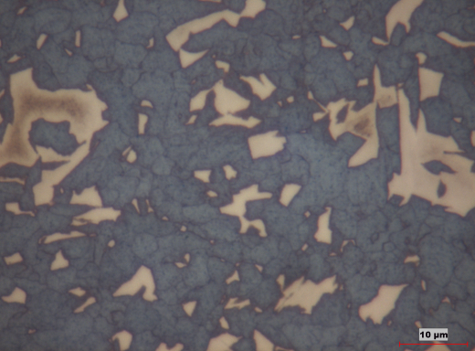
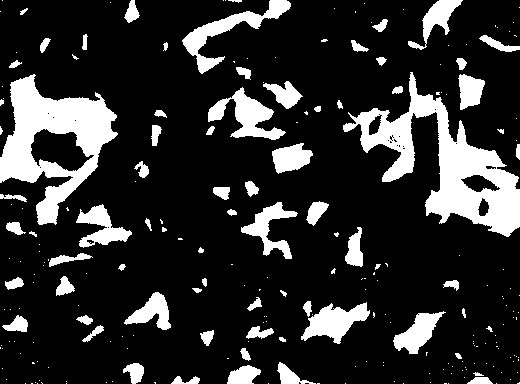
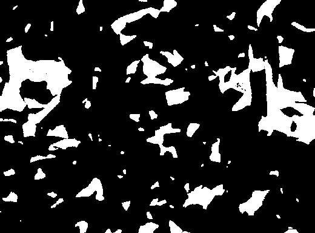
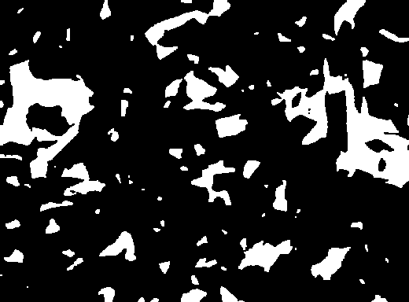
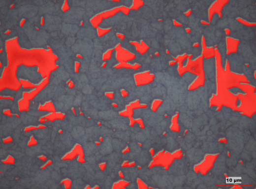

# Yaz Stajı · Görüntü İşleme ile Kalite Kontrol

**Yaz stajı · Ağustos–Eylül 2026**

Bir üretim hattında kalite kontrolü desteklemek için OpenCV tabanlı iki görüntü işleme aracı geliştirdim:

1. **Slab kenar eğriliği tespiti:** Kameradan alınan görüntüde slabın sol ve sağ kenarlarını bulup her kenarı *düz*, *iç bükey* veya *dış bükey* olarak sınıflandırır.
2. **Mikroyapı faz analizi:** Metal mikroyapı görüntülerinde renk / parlaklık farkına göre fazları ayırır ve her fazın alan oranını yüzde olarak hesaplar.

> Şirkete ait görüntüler, veri setleri ve belgeler bu repoda yer almaz. Kodlar kendi görüntülerinizle çalıştırılabilir.

## 1. Slab kenar eğriliği tespiti

[`01_Slab_Kenar_Egriligi/`](01_Slab_Kenar_Egriligi)

Kameradan gelen slab görüntüsünü işleyip sonucu otomasyon sistemine geri yazan uçtan uca bir akış kurdum:

```
OPC UA sunucusu (Kepware) ──► genişlik + tetik ──► Python ──► slab tipi (TIP_1 / TIP_2) ──► tipe özel ROI
                                                                                              │
Excel kaydı ◄── sonuç kodu (düz / iç bükey / dış bükey) ──► OPC UA'ya geri yazma ◄── görüntü işleme
```

**Görüntü işleme adımları**

1. Parlaklık / kontrast ayarı, gri dönüşüm ve Gaussian bulanıklaştırma
2. Canny ile kenar bulma ve morfolojik kapama
3. Slab tipine göre seçilen ROI içinde en büyük bölgenin (slab gövdesi) bulunması
4. Sol ve sağ kenardan nokta örnekleme, ikinci derece polinom uydurma (`np.polyfit`)
5. Eğrilik katsayısı `a2` ve uyum hatası `RMS` ile karar: **düz**, **iç bükey** veya **dış bükey**

**Otomasyon entegrasyonu**

- OPC UA istemcisi (`python-opcua`) ile slab genişliği ve tetik sayacı okunur. Genişliğe göre slab tipi belirlenir.
- Tetik sayacı her değiştiğinde yeni slab analiz edilir. Bu yöntem, aynı genişlikte art arda gelen slabları da yakalar.
- Sonuç sayısal koda çevrilip (`0` düz, `1` iç bükey, `2` dış bükey) OPC UA tag'lerine geri yazılır. Sunucunun zaman damgalı yazımı reddetmesi, zaman damgası boş bir `DataValue` ile çözüldü.
- Her analiz Excel dosyasına satır olarak eklenir (`openpyxl`).

**Öğrendiğim önemli nokta:** Sabit bir ROI, farklı genişlikteki slablarda hatalı sonuç veriyordu. ROI slabın altındaki merdanelere taşınca morfolojik kapama slabı gürültüyle birleştiriyor ve kenarlar yanlış bulunuyordu. Çözüm olarak her slab tipi için ayrı ROI tanımlanan bir yapı kurdum. Doğrulamada kenar uyum hatası 0,5 pikselin altına indi.

| Dosya | Açıklama |
|---|---|
| `slab_curvature_pipeline.py` | Görüntü işleme ve karar akışı; slab tipine göre ROI seçen `process_slab()` fonksiyonu |
| `otomasyon_entegrasyonu.py` | Ana program: OPC UA'yı dinler, tetiklemede analizi çalıştırır, sonucu geri yazar ve Excel'e kaydeder |
| `opcua_baglanti_testi.py` | OPC UA bağlantısını ve tag'leri doğrulamak için ilk adım testi |
| `gorsel_test_arayuzu.py` | Tek bir fotoğraf seçip 11 ara aşamayı ızgara hâlinde gösteren test aracı |

## 2. Mikroyapı faz analizi

[`02_Mikroyapi_Faz_Analizi/`](02_Mikroyapi_Faz_Analizi)

**Yöntem**

1. Görüntü HSV renk uzayına çevrilir.
2. Seçilen faz için renk merkezi (H), tolerans ve S/V alt sınırlarıyla ham maske oluşturulur.
3. Morfolojik açma (gürültü silme) ve kapama (boşluk doldurma) ile maske temizlenir.
4. Faz piksellerinin toplam piksele oranı **faz yüzdesi** olarak verilir. Sonuç renkli bir bindirme (overlay) olarak gösterilir.

| Dosya | Açıklama |
|---|---|
| `faz_ayristirma_arayuz.py` | **Son sürüm arayüz (Tkinter):** `goruntuler/` klasöründen rastgele fotoğraf getirir, kaydırıcılarla H / tolerans / S-V eşiklerini ve gürültü temizliğini ayarlar, faz oranını anlık gösterir ve tüm ara aşamaları (ham maske, açma, kapama, nihai maske, renkli bindirme) ayrı görseller olarak kaydeder |
| `otsu_esikleme.py` | Otsu eşiğini referans alıp ayarlanabilir hassasiyetle tane sınırlarını ayıran deneme |
| `hsv_oranlama.py` | HSV kaydırıcılarıyla maske çıkarıp alan oranı hesaplayan ilk sürüm |
| `goruntuler/` | Arayüzün açılışta okuduğu 7 örnek mikroyapı görüntüsü |
| `ornek_ciktilar/` | Arayüzün gerçek bir çalıştırmada kaydettiği aşama çıktıları |

**Örnek çıktılar** (arayüzün kaydettiği gerçek aşamalar)

| Orijinal | Ham renk maskesi | Gürültü silinmiş (açma) |
|---|---|---|
|  |  |  |
| **Boşluklar kapatılmış (kapama)** | **Nihai faz maskesi** | **Renkli bindirme** |
|  |  |  |

## Çalıştırma

```bash
pip install -r requirements.txt
python 02_Mikroyapi_Faz_Analizi/faz_ayristirma_arayuz.py
```

Faz analizi arayüzü hangi klasörden çalıştırılırsa çalıştırılsın kendi klasöründeki `goruntuler/` klasörünü okur ve örnek görüntülerden birini açılışta gösterir. "Aşamaları Kaydet" düğmesi çıktıları yine kendi klasöründeki `Asama_Ciktilari/` klasörüne yazar. Kendi mikroyapı görüntülerinizi `goruntuler/` klasörüne ekleyebilirsiniz.

Slab analizini tek bir fotoğrafla denemek için `python 01_Slab_Kenar_Egriligi/gorsel_test_arayuzu.py` çalıştırın. Otomasyon entegrasyonu çalışan bir OPC UA sunucusu (ör. Kepware simülasyon cihazı) gerektirir.

## Kullanılan teknolojiler

Python · OpenCV · NumPy · OPC UA (Kepware) · openpyxl · Tkinter · Pillow · HSV renk uzayı · Morfolojik işlemler · Otsu eşikleme · Polinom uydurma
